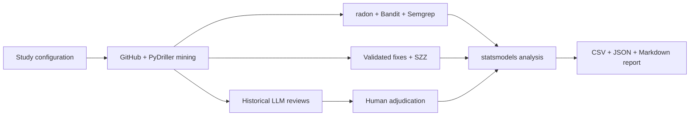

# codeprov

Trace declared AI assistance in GitHub pull requests, measure code quality, and evaluate historical LLM reviews.

[Quickstart](#quickstart) · [Historical pilot](#historical-pilot) · [Pipeline](#pipeline) · [Methodology](#methodology) · [Citation](#citation)

> [!IMPORTANT]
> **No AI trailer does not mean human-written code.** `codeprov` distinguishes declared assistance, independently verified manual authorship, and unknown provenance. Results are observational associations—not causal effects.

## Why this exists

Comparing AI-assisted and manual code requires more than counting commits. Provenance labels can be missing, scanner findings can predate a change, bug attribution is uncertain, and historical human reviews are incomplete ground truth.

`codeprov` preserves the evidence behind each measurement: PR membership, original commit snapshots, co-author trailers, before/after scanner output, validated bug-fix links, and review-time diffs. A local Python CLI turns that evidence into auditable datasets and reports without executing mined repository code.

## Quickstart

Requires **Git**, [uv](https://docs.astral.sh/uv/), and Python **3.11–3.13**; Python **3.12** was exercised. Cloning this public repository requires no GitHub account.

```sh
git clone https://github.com/MaheshBhushan/codeprov.git
cd codeprov
uv sync --locked --python 3.12
uv run --locked python -m unittest discover -s tests -v
uv run --locked python -m codeprov.demo --output runs/offline-demo
```

The offline demo creates a deterministic local Git history and prints its report path. It exercises PyDriller, Radon, real Bandit/Semgrep scans, deleted-line SZZ, the HTTP reviewer client against a loopback fixture server, response validation, synthetic adjudication, analysis guards, and reporting. It uses no GitHub access, paid inference, or real API credential. GitHub discovery is bypassed and tested separately with mocked API transport.

All demo commits, labels, responses, and annotations are synthetic. `demo-summary.json` records expected/actual counts, stage states, Git SHAs, bypasses, and artifact paths. The generated report starts with a synthetic marker. Its three commits produce `not_estimable` models. The seeded model tests validate successful fitting separately. The command supports repeated runs in its own marked output directory and refuses other nonempty directories. A runtime-version change requires a fresh output directory.

See [VERIFICATION.md](VERIFICATION.md) for reproduced checks and remaining limits. Raw evidence, databases, and environments stay local and are excluded from Git.

Optional public mining uses the network:

```sh
uv run --locked codeprov --study study.pilot.toml run --export-only
uv run --locked codeprov --study study.pilot.toml status
```

> [!NOTE]
> Export-only mode needs no LLM credential and makes no model call. Public GitHub mining can run unauthenticated, but larger samples need `GITHUB_TOKEN` to avoid rate limits. Missing fix labels or adjudications stay pending; insufficient cohorts produce `not_estimable`, never invented scores.

## Historical pilot

The earlier pilot narrative records a smoke run `d3ddbd7a02a8fd33`. The current offline verification did not rerun or independently audit that public cohort. That run used [`study.pilot.toml`](study.pilot.toml): merged `pallets/click` PRs created on 2026-08-31, capped at two, with an observation cutoff of 2026-10-13.

| Observed artifact | Count | Evidence |
| --- | ---: | --- |
| Merged PRs | 2 | GitHub API records and exact commit membership |
| Unique PR commits | 2 | PyDriller source snapshots |
| Historical inline comments | 6 | Original comment commit IDs retained |
| Python file measurements | 3 | Bandit and Semgrep completed every measured file |
| Historical review requests | 1 | Original-snapshot payload exported; no model response fabricated |

This is a **smoke cohort, not a representative research sample**. It was selected to exercise inline-review extraction. Its defect windows are incomplete, no validated fixes were supplied, and both commits have unknown provenance. **No research effects or live-LLM precision/recall were estimated.**

Earlier throwaway-check claims have no committed test artifacts from that run. The repository test suite and offline demo provide reproducible checks; [VERIFICATION.md](VERIFICATION.md) states their exact coverage. Neither the historical pilot nor the current synthetic fixtures establish empirical review quality or model effects.

The historical pilot report is local and has no committed benchmark artifact. The optional public mining command produces a new report, evidence export, and model diagnostics; GitHub data may change between fresh runs.

## Pipeline



Stages are explicit and resumable. Successful API pages are cached; keys prevent duplicate evidence rows. A failed stage records its error and stops the command. `pending`, `partial`, and `not_estimable` remain visible in `status` and the report.

## Usage

Global `--study` and `--results` options precede the subcommand. Use [`study.toml`](study.toml) for the broader three-repository selection, or edit a study before starting a new run.

```sh
uv run codeprov --study study.pilot.toml init
uv run codeprov --study study.pilot.toml mine
uv run codeprov --study study.pilot.toml measure
uv run codeprov --study study.pilot.toml szz
uv run codeprov --study study.pilot.toml review --export-only
uv run codeprov --study study.pilot.toml analyze
uv run codeprov --study study.pilot.toml report
```

### Calling the reviewer

Set `[review].endpoint` to an OpenAI-compatible chat-completions endpoint and `[review].model` to a provider-supported model ID. The example config uses `gpt-6.1-sol`; provider availability is **not** implied. Configuration loading rejects reviewer efforts other than `low`; this protocol requires `effort = "low"`. Supply `OPENAI_API_KEY` through the environment, then run:

```sh
uv run codeprov --study study.pilot.toml review
```

After completed reviews, fill the human-only worksheet at `runs/<study-hash>/review/adjudication-worksheet.json`. Save its **`adjudications` object alone** as `adjudications.json` before running:

```sh
uv run codeprov --study study.pilot.toml evaluate --adjudications adjudications.json
uv run codeprov --study study.pilot.toml analyze
uv run codeprov --study study.pilot.toml report
```

New completed reviews or changed adjudications invalidate derived scores and reports. Rebuild them after evaluation. Saved requests and prompt hashes support inspection; oversized or unavailable snapshots are skipped explicitly rather than truncated.

## Methodology

| Question | Measurement | Interpretation boundary |
| --- | --- | --- |
| Who wrote it? | Terminal `Co-Authored-By` trailers plus independent manual labels | Exact assistant-email matches show declared assistance, not a complete account of authorship |
| Is it maintainable? | radon MI, LOC, and summed function/method complexity; parent/head deltas | Class aggregates are not double-counted; missing sides and root/merge commits have explicit exclusions |
| Is it secure? | Bandit and pinned local Semgrep rules; introduced/resolved findings | Warnings are not confirmed vulnerabilities; failed scans are missing data, not clean scans |
| Is it defect-prone? | PyDriller deleted-line SZZ over validated fixes and equal observation windows | Links are candidate attributions; incomplete labels cannot establish defect freedom |
| Does the reviewer help? | Issue-level human matching, recovery precision/recall, and adjudicated finding validity | Historical comments are incomplete ground truth; valid unmatched discoveries are reported separately |

<details>
<summary>Provenance, statistical models, and scientific limitations</summary>

- `declared_ai`: a terminal co-author email matches the frozen assistant identity list.
- `verified_manual`: independent evidence supports manual authorship with no conflicting AI declaration.
- `unknown`: no qualifying declaration or contradictory evidence. Ordinary human co-authors do not establish manual authorship. Conflicts are excluded from provenance models.
- Continuous outcomes use Gaussian `MixedLM`; binary scanner/SZZ outcomes use Bayesian variational `BinomialBayesMixedGLM`, with repository random intercepts. Confidence and approximate posterior credible intervals are labeled separately.
- Commit models control change size, prior changed-file complexity, and author experience measured as reachable ancestor commits with the exact author email. Declared-AI versus verified-manual and declared-AI versus unknown are separate comparisons.
- Fits require at least 20 complete observations, two repositories, and five observations per cohort. Binary fits also require five events/non-events and nonseparated cohort cells. Missing data, rank deficiency, and failed convergence return explicit reasons rather than coefficients.
- Held-out review models use exploratory, unweighted per-PR empirical logits with a 0.5 continuity correction—not a binomial likelihood. Mixed-provenance PRs are excluded.
- Trailer disclosure is selective. SZZ can misattribute refactors and miss addition-only fixes; unresolved squash histories and incomplete follow-up windows remain excluded. Semgrep rules cover only a limited security subset. Report all comparisons rather than selecting significant outcomes.

</details>

<details>
<summary>Historical review isolation and human adjudication contract</summary>

Requests use the original human-comment commit SHA and a historical merge-base diff. They contain no human comments, PR descriptions, later fixes, or provenance labels. Findings must identify a changed Python file and a valid new-side diff line; the model receives no execution tools.

The input has `version: 1` and a `snapshots` array. Each reviewed snapshot requires its frozen `snapshot_id` and `split`, plus:

- `comments`: `comment_id`, `disposition` (`issue` or `ignore`), `canonical_comment_id`, and a rationale. Group duplicate comments under one issue; ignored comments use a null canonical ID.
- `finding_groups`: `canonical_finding_id`, `finding_ids`, a rationale, and a human-assessed `genuine` boolean.
- `matches`: one-to-one canonical `finding_id`/`comment_id` pairs with a rationale.

Coverage must be complete. Bot and non-Python comments are excluded; replies need human grouping or explicit exclusion. Unknown IDs, duplicate matches, cross-snapshot matches, and development/test mixing are rejected. Blank labels remain pending, not negative.

Recovery precision is `TP/(TP+FP)`; recovery recall is `TP/(TP+FN)`. Adjudicated precision counts independently valid finding issues, including discoveries absent from historical comments. Undefined denominators are null. Scores aggregate per PR and frozen split, with issue grouping within each historical snapshot. See [`evaluation.py`](codeprov/evaluation.py) for the full contract and validation rules.

</details>

## Configuration and reproducibility

Study files specify repositories, inclusive PR creation dates, observation cutoff, fixed SZZ follow-up, per-repository PR cap, exact assistant emails, and the local Semgrep rule file. Freeze `development_repositories` before adjudication; other selected repositories form the test split.

Optional `manual_labels` and `bug_fixes` paths point to JSON arrays whose records contain `repo`, a full 40-character `sha`, and a nonempty `evidence` description. Use independently supported labels; bug-fix keywords alone are insufficient. [`config.py`](codeprov/config.py) validates the inputs before mining.

[`uv.lock`](uv.lock) pins dependencies. The run manifest records selections, input-file hashes, review settings, and runtime versions. Changed inputs create a new study hash; changed runtime versions require a different `--results` root. Frozen rules and evidence-file copies are retained with the run.

| Local artifact | Purpose |
| --- | --- |
| `manifest.json`, `study.sqlite` | Frozen inputs, versions, evidence records, and stage status |
| Raw API/scanner/review files | Source responses, errors, and exact review payloads |
| `commit-analysis.csv`, `review-analysis.csv` | Model inputs and missingness |
| `analysis.json` | Coefficients, uncertainty, and diagnostics—or reasons a fit is unavailable |
| `report.md`, `evidence.json` | Readable results and normalized audit export |

> [!WARNING]
> Repositories are untrusted input. The pipeline does not execute their code or install their dependencies, but static analyzers run under your user's permissions; use OS/container isolation for adversarial sources. Live review sends selected code to the configured provider. Only transmit code you are allowed to share, and never commit API keys or private evidence.

## Code map

[CLI and run manifest](codeprov/cli.py) · [GitHub mining](codeprov/mining.py) · [Provenance](codeprov/provenance.py) · [Measurements](codeprov/metrics.py) · [SZZ](codeprov/szz.py) · [Reviewer](codeprov/review.py) · [Evaluation](codeprov/evaluation.py) · [Models](codeprov/analysis.py) · [Report](codeprov/report.py)

## Citation

This is a software repository, not a published paper. Cite the repository and record the commit used for an experiment:

```bibtex
@misc{codeprov,
  author = {{MaheshBhushan}},
  title = {{codeprov}: Declared AI Code Provenance and Historical Review Evaluation},
  howpublished = {\url{https://github.com/MaheshBhushan/codeprov}},
  note = {Software repository; record the commit used}
}
```

## License and contact

No license file is included; do not assume reuse permission. Contact [MaheshBhushan](https://github.com/MaheshBhushan) for licensing questions. For bugs or collaboration, [open an issue](https://github.com/MaheshBhushan/codeprov/issues) with the study configuration, dependency versions, and relevant errors—without credentials or private source.
